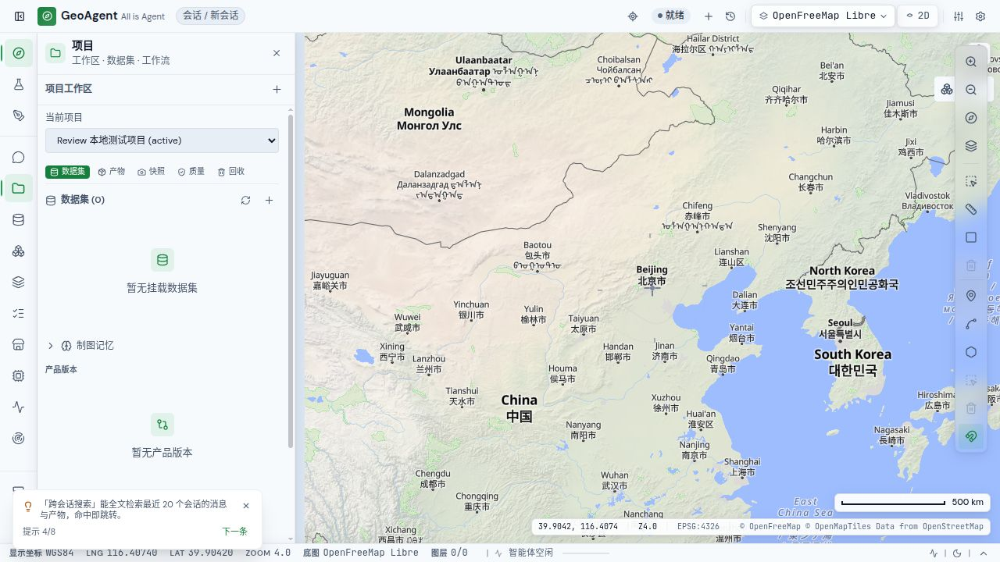

# Authenticated UI checkpoint — 2026-11-06

The parent inspected the actual production frontend on localhost3108 with the isolated API on127.0.0.1:8001. The preview database is disposable and owned by this task; it was freshly migrated through revision0103. A synthetic local administrator was created through `manage.py create-admin --password-stdin`. No real user's credentials or data were used.

The actual browser journey followed the guest model-settings login recovery action to Account, signed in, opened Projects, and created `Review 本地测试项目`. The saved project appeared as active in the current-project selector, with the expected empty dataset and product states. The base map remained loaded and map controls stayed visible at1280×720.

One additional low-severity interaction defect was confirmed: the create button remained enabled for an empty project name, while clicking returned silently. `project-tab.tsx` now disables creation for blank/whitespace names. The existing complete project-tab suite passed17 tests. This source fix still requires the final rebuilt-browser confirmation; the image below records the successful authenticated project journey before that rebuild.

This checkpoint extends the earlier guest UI audit. It does not claim paid LLM execution, user-data import, mobile touch coverage or real screen-reader testing. Preview services remain available for final validation; later integrated source/build changes require revalidation of affected flows.
