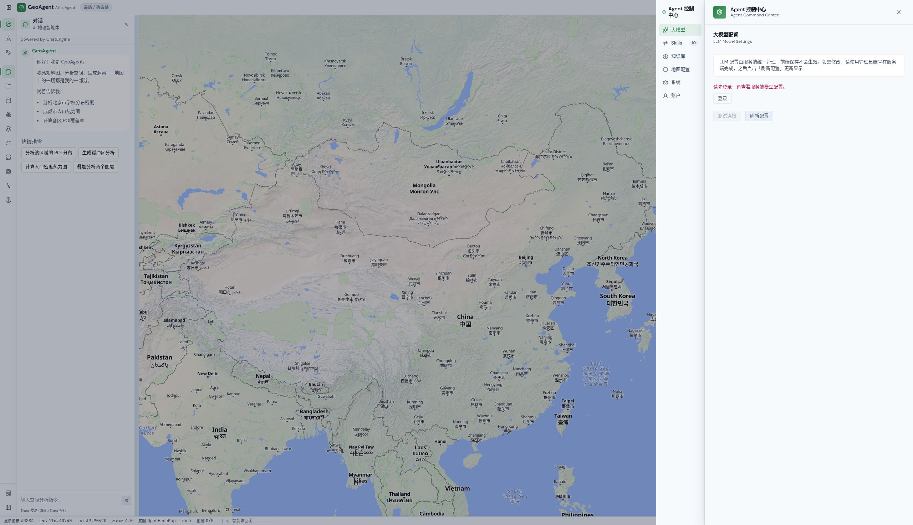
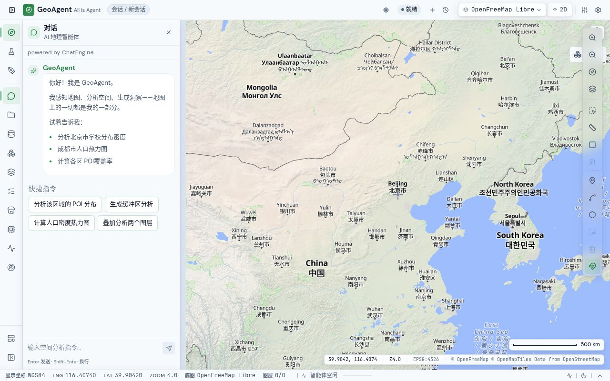

# Production UI review — 2026-11-06

The reviewed local production build at `http://127.0.0.1:3108/` uses the isolated backend on8001. Chrome was used after the in-app browser proved unavailable in this agent. These are actual saved screenshots and DOM/accessibility observations, captured before proposing the UI fixes and again after rebuilding. No stored user context was available.

## Journey coverage and observed health

| Step | Journey / conditions | Observed health | Screenshot |
| --- | --- | --- | --- |
| 1 | First-open onboarding, default desktop viewport2560×1473 | Guide is centered and clear of the toolbars; skip and next are reachable. The working OpenFreeMap map is visible behind it. | `01-onboarding.jpg` |
| 2 | Close guide, inspect empty chat and map workbench | Base map, attribution, navigation, status bar and input render; empty send stays disabled. The previous Carto API-key placeholder is absent. | `02-workbench.jpg` |
| 3 | Guest opens settings → models, then follows the recovery action | Previously raw English401 with no next step; fixed localized sign-in explanation, disabled test and working account-page action. | Before `03-settings.jpg`; final `06-llm-recovery-fixed.jpg` |
| 4 | Settings → system → general | Previously hardcoded fallback0.1.2 disagreed with the0.1.3 build. Final uses package version and displays0.1.3. | `07-system-version-fixed.jpg` |
| 5 | System → cluster health, as guest | Basic health and version load; component details explicitly require admin. The endpoint caption now states admin rather than JWT. No private component topology appears. A global metrics channel error is bounded in its own row. | Before `04-health-permission.jpg`; final `08-health-permission-fixed.jpg` |
| 6 | Open template gallery | Two-column cards, search, categories and page controls are visible. Repeated “Apply” controls previously had identical accessible names; final DOM names include each template title. | Before `05-template-library.jpg`; final `09-template-names-fixed.jpg` |
| 7 | Narrow desktop1280×800, then keyboard focus check | Workbench input, map controls and gallery header/paging remain visible without horizontal page overflow in the inspected screens. Tab from the settings panel's last action returns to its first tab. Restored the original viewport afterward. | `10-template-narrow-desktop.jpg`, `11-workbench-narrow-desktop.jpg` |

Every screenshot is in `docs/reviews/assets/2026-11-06-ui/` and was opened from the exact saved file for inspection. Files01–05 document the initial state;06–11 document the corrected flows. File12 records the final production rebuild after the generated basemap CRS profile update. Screenshots retain surrounding map/tool context.

## Findings and dispositions

| Finding | Severity | Step | Disposition / final behavior |
| --- | --- | --- | --- |
| Default map requires unavailable Carto key, preventing the main task | High | 1–2 | Root fixed provider defaults/credential gating. This production review confirms a loaded OpenFreeMap base map and usable workbench. |
| Guest model settings provide no useful recovery from401 | Medium | 3 | Fixed: localized sign-in prompt, explicit login action switches to Account; unavailable test action is disabled. Real browser confirms the destination form. |
| Model test action/progress/result ignore the selected language | Low | 3 | Fixed: both locale catalogs supply the action, progress and result messages; Chinese production screenshot and localization tests verify the change. |
| System version has a stale hardcoded fallback | Low | 4 | Fixed: package metadata is the fallback authority; browser displays0.1.3. |
| Health details caption implies any JWT can access an admin-only resource | Low | 5 | Fixed both locales; actual guest denial remains explicit. |
| Template apply actions are ambiguous in the accessible name | Low | 6 | Fixed: each button includes its template title in visually hidden text. Actual DOM verifies “学术论文浅色底图: 应用” and distinct names for other cards, while preserving the visible short label. |

## Verification and practical limits

The final production build completed successfully (`/tmp/frontend-production-build-final7.log`) and3108 was restarted with it. `/tmp/frontend-final-types8.log` and `/tmp/frontend-final-lint8.log` both exited0. The UI-focused31 tests and final localization/key-completeness15 tests passed. **Final frozen-source full suite:519 test files passed,4,855 tests passed and1 expected failure** (`/tmp/frontend-final-all8.log`, `pnpm exec vitest run --maxWorkers=2`). This run and build include the corrected generated GCJ-02 basemap profile. The original performance bounds passed in this complete run; they were not relaxed. The final browser reload again showed a loaded OpenFreeMap workbench, an empty console-error list and no loading overlay. The exact saved final screenshot is `12-final-production-workbench.jpg`.

Chrome console error capture for the completed journey returned an empty list. This describes the inspected tab/session, not a claim that every network dependency or privileged path is error-free. The guest/API permission boundary is also covered by server and frontend behavior tests. This review did not sign in, run paid model calls, upload user data or perform destructive operations. Privileged workflows, mobile touch interaction, real screen-reader behavior and a measured color-contrast audit are not claimed as browser-covered or WCAG-certified. The backend on8001 is the isolated preview instance; the API route/security fixes have separate automated evidence.

Build warning retained for the integration owner: installed TypeScript5.0.2 is below Next's recommended5.1.0 minimum. Type checking and the build succeeded; this is a dependency-upgrade follow-up, not an ignored build failure. No dependency or debt baseline was changed in this UI review. Final debt ratchet also passed (`/tmp/frontend-api-harness-final-debt.log`); `git diff --check` was clean. Final HTTP/CSP smoke returned two200 responses with distinct per-request nonces matching SSR and `strict-dynamic`.
